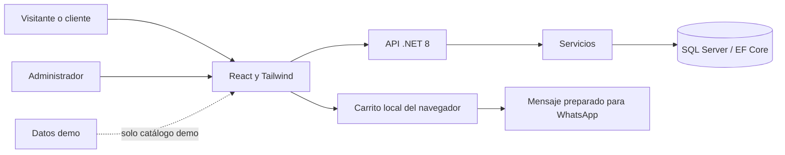

# Estado general y evolución del ecommerce

**Fecha de corte:** 10 de septiembre de 2026  
**Enfoque actual:** ropa masculina y accesorios de estilo urbano  
**Propósito:** entender el producto y decidir qué construir después, sin revisar el código archivo por archivo.

## 1. Qué estamos construyendo

Una tienda web para negocios locales que muestra su catálogo, permite armar un carrito y prepara un pedido para WhatsApp. El objetivo comercial es convertirla en una plantilla que pueda personalizarse y ofrecerse a distintos negocios.

La aplicación tiene tres áreas: una tienda pública, un panel del administrador y una cuenta de cliente. La interfaz ya permite demostrar la experiencia de compra con fotografías y productos de muestra. La lógica del servidor permite gestionar productos, categorías y perfiles de clientes.

**Estado actual:** MVP de catálogo con carrito y contacto por WhatsApp. Todavía no existe un sistema de pedidos guardados, cobros, inventario ni seguimiento de entregas. Tener un perfil con dirección no significa que ya haya un proceso de envío conectado.

### Lectura rápida

| Pregunta | Respuesta actual |
|---|---|
| ¿Se puede mostrar una tienda con productos? | Sí. Demo con 32 artículos, fotografías diferentes y cinco categorías. |
| ¿Cada producto tiene una página propia? | Sí: imagen grande, descripción, precio y acceso al carrito. |
| ¿El negocio puede administrar su catálogo? | Hay panel y API implementados; el flujo completo requiere SQL Server configurado y validado. |
| ¿Hay cuentas para compradores? | Sí, implementadas. Su prueba con SQL Server quedó pendiente por decisión del usuario. |
| ¿Se guardan las compras? | No. El carrito es local y no existe una entidad de pedido. |
| ¿Se cobra desde la web? | No. Pago y entrega se acuerdan con el negocio. |
| ¿Ya se pueden alojar varias tiendas en un panel central? | No. Se plantea una instalación y base de datos por negocio. |
| ¿Está desplegada para producción? | No hay despliegue productivo documentado ni configuración Docker en el proyecto. |

## 2. Qué existe actualmente

### Tienda pública

- Header con nombre del negocio, buscador central, acceso a Mi cuenta y Carrito con icono.
- Barra inferior con Productos y desplegables de Categorías, Envíos y Cómo comprar.
- Portada de moda urbana, secciones de colección con fotos y footer con navegación.
- Catálogo adaptable a escritorio y celular.
- Búsqueda por nombre o descripción, sin distinguir mayúsculas ni acentos.
- Filtros por categoría, contador de resultados y limpieza de filtros.
- Orden por selección original, menor precio, mayor precio o nombre.
- Estados de carga, error, catálogo vacío y recuperación de errores de imagen.
- Los visitantes y clientes solo ven productos activos.

No hay ofertas reales, cupones ni descuentos calculados. Tampoco hay reseñas, favoritos ni recomendaciones personalizadas.

### Tarjetas y detalle de producto

Cada tarjeta muestra fotografía, categoría, nombre, descripción breve y precio en MXN. Se puede abrir el detalle desde la imagen, el nombre o el botón **Ver producto**. También permite agregar al carrito y confirma visualmente la acción.

La página de detalle incluye:

- Foto principal ampliada y miniaturas.
- Nombre, categoría, descripción completa y precio.
- Agregar al carrito, consultar carrito y regresar al catálogo.
- Información orientativa sobre tallas, disponibilidad y entrega.
- Estados para producto inexistente, inactivo o error de carga.

**Límite de la galería:** el producto de base de datos guarda una URL de imagen. El componente visual acepta fotos adicionales si se proporcionan, pero aún no hay gestión ni persistencia de varias fotografías en la API. Los espacios «Sin fotografía» son lugares reservados, no controles de subida.

### Carrito y WhatsApp

- Agregar, eliminar y modificar cantidades entre 1 y 99.
- Total en MXN, calculado en centavos para evitar residuos de coma flotante.
- Persistencia local al recargar la página.
- Actualización del carrito con los precios y productos activos del catálogo al cargarlo.
- Eliminación de referencias a productos que ya no están disponibles en el catálogo cargado.
- Generación de una URL de WhatsApp con nombres, cantidades, precios unitarios y total.
- El comprador debe enviar el mensaje desde WhatsApp; abrir la pestaña no equivale a enviar el pedido.

El carrito no reserva existencias, no se comparte entre dispositivos y no se guarda asociado a la cuenta. Sus cantidades no representan stock real. El precio todavía no se confirma mediante una orden calculada en el servidor. La dirección del perfil no se incorpora automáticamente al mensaje.

### Administración

El panel permite iniciar sesión, gestionar productos y categorías y cerrar sesión.

| Operación | Alcance |
|---|---|
| Crear y editar productos | Nombre, descripción, precio, URL de imagen, categoría y visibilidad. |
| Activar o desactivar | Un producto inactivo queda fuera del catálogo público. |
| Eliminar productos | Eliminación con confirmación en la interfaz. |
| Gestionar categorías | Crear, editar y eliminar. |
| Proteger categorías ocupadas | No permite eliminar una categoría con productos asociados, incluidos inactivos. |

El administrador inicial se crea mediante un comando de aprovisionamiento. No existe contraseña predeterminada. No hay todavía panel de pedidos, inventario, clientes, ventas ni configuración visual del negocio.

### Cuenta y perfil de cliente

Acceso desde **Mi cuenta** o `/account`.

| Campo | Estado y reglas |
|---|---|
| Nombre | Obligatorio; máximo 100 caracteres. |
| Apellido | Obligatorio; máximo 100 caracteres. |
| Teléfono | Opcional; validación de formato y longitud. |
| Correo electrónico | Obligatorio, con formato válido y único entre clientes. |
| Dirección | Obligatoria; texto completo, entre 10 y 500 caracteres tras las validaciones aplicables. |
| Contraseña | Registro con mínimo 12 caracteres; se almacena como hash. |

El cliente puede registrarse, iniciar sesión, consultar su perfil, editar sus datos y cerrar sesión. La comparación del correo ignora mayúsculas y espacios en los extremos. Existe un índice único en la base de datos para impedir duplicados incluso ante solicitudes simultáneas.

Cada cliente solo accede a su propio perfil. El servidor obtiene la identidad del token, no de un Id enviado por el formulario. El administrador es una entidad separada que inicia sesión por nombre de usuario; no tiene campo de correo.

**Pendiente:** comprobar el registro y edición de extremo a extremo con SQL Server. Esa prueba quedó pausada; no se ejecutó como parte de esta documentación. Tampoco se han implementado verificación de correo, recuperación o cambio de contraseña, múltiples direcciones ni eliminación de cuenta.

## 3. Demo y operación real: diferencia importante

| Aspecto | Modo demo | Modo real |
|---|---|---|
| Fuente de productos | Datos locales de ejemplo | API y SQL Server |
| Contenido actual | 32 productos ficticios | Lo registrado por el administrador |
| Imágenes | Referencias de Unsplash con créditos | URL introducida al administrar el producto |
| Precios | Ilustrativos | Definidos por el negocio |
| Carrito | Funciona con almacenamiento separado | Funciona con productos del servidor |
| Botón de pedido | Deshabilitado | Abre WhatsApp si existe teléfono válido y catálogo actualizado |
| Panel administrativo | Siempre usa la API; no edita los ejemplos | Edita la base real |
| Cuenta de cliente | Siempre usa la API; no simula usuarios | Guarda perfiles reales |

La demo está habilitada en desarrollo mediante `VITE_DEMO_CATALOG=true`. Cambiarlo a `false` y reiniciar el frontend activa el catálogo real. El build normal de producción no activa la demo por defecto.

### Contenido de la demo

| Categoría | Productos |
|---|---:|
| Playeras | 7 |
| Gorras | 6 |
| Tenis | 7 |
| Sudaderas | 6 |
| Chamarras | 6 |
| **Total** | **32** |

Cada producto tiene una fotografía principal distinta. La portada y las tarjetas de colección pueden reutilizar fotos del catálogo como parte de la composición visual. Los nombres y precios son ejemplos y no prueban disponibilidad, autenticidad de marcas ni inventario vendible.

## 4. Cómo funciona el sistema por dentro

La estructura es sencilla: la interfaz presenta la tienda; la API valida permisos y aplica reglas; SQL Server guarda la información persistente.

| Parte | Responsabilidad |
|---|---|
| React, Vite y Tailwind CSS 4.1 | Pantallas, navegación, formularios y diseño adaptable. |
| Axios | Comunicación del frontend con la API. |
| Context API | Estado del carrito y sesión de cliente. |
| ASP.NET Core .NET 8 | Endpoints HTTP, autenticación, autorización y validación. |
| Servicios | Reglas de productos, categorías, clientes y autenticación. |
| Entity Framework Core | Modelo de datos y migraciones. |
| SQL Server | Persistencia de productos, categorías, administradores y clientes. |

Se utiliza inyección de dependencias y separación entre controladores y servicios. Los DTOs definen lo que puede entrar y salir de la API y evitan devolver hashes de contraseña o entidades completas.

La navegación actual resuelve rutas desde el navegador y usa enlaces normales. Para alojarla, el servidor web debe devolver la aplicación en rutas como `/account`, `/admin` y `/products/1001` al abrirlas directamente.

### Datos que se guardan

| Entidad | Información principal | Relación |
|---|---|---|
| AdminUser | Usuario y hash de contraseña | Independiente de los clientes. |
| Category | Nombre y descripción | Tiene productos asociados. |
| Product | Nombre, descripción, precio, imagen, visibilidad y categoría | Pertenece a una categoría. |
| Customer | Nombre, apellido, teléfono, correo, dirección y hash | Aún no tiene pedidos o direcciones separados. |

No existen todavía entidades de pedido, detalle de pedido, variante, imagen adicional, pago, envío ni negocio.

## 5. Accesos y seguridad implementada

| Acción | Visitante | Cliente | Administrador |
|---|:---:|:---:|:---:|
| Consultar productos activos y categorías | Sí | Sí | Sí |
| Ver productos inactivos con sesión | No | No | Sí |
| Editar catálogo | No | No | Sí |
| Registrarse como cliente | Sí | — | — |
| Consultar y editar su perfil de cliente | No | Sí | No mediante el rol Admin |
| Armar carrito público | Sí | Sí | Sí |

- Tokens JWT con una hora de vigencia y validación de firma, emisor, audiencia y expiración.
- Roles separados: `Admin` y `Customer`.
- Hash de contraseñas mediante el servicio de contraseñas de ASP.NET Core Identity.
- Limitación de intentos en login y registro.
- CORS configurado para el frontend local.
- Sesiones de cliente y administrador separadas en `sessionStorage`.
- Carrito guardado en `localStorage`; dirección y teléfono del perfil no se guardan allí.
- Secretos de servidor fuera del código de configuración público.

El cierre de sesión elimina la sesión del navegador, pero no existe todavía una lista de revocación de tokens. No hay renovación automática de sesión. Las defensas para producción, recuperación de cuentas y operación deben completarse según el alcance del lanzamiento.

## 6. Qué se ha comprobado y qué no

Esta sección resume evidencia de entregas anteriores, no una nueva ejecución de pruebas en la fecha de este documento.

| Validación | Evidencia disponible |
|---|---|
| Compilación del frontend | Pasó en las entregas realizadas. |
| Compilación del backend | Pasó con las cuentas y roles. |
| Pruebas de carrito y WhatsApp | Cinco pruebas disponibles y previamente aprobadas. |
| Pruebas de cuentas | Cinco pruebas aprobadas usando SQLite temporal en memoria. |
| Permisos HTTP | Comprobados rechazos 401, 403 y validaciones 400 en solicitudes seleccionadas. |
| Revisión visual | Se revisaron tienda, fotografías, detalle, carrito y formulario de registro; hubo revisión móvil de la tienda. |
| Migraciones | Inicial y AddCustomers generadas. |
| Registro/perfil con SQL Server real | Pendiente y pausado por el usuario. |
| Venta completa en producción | No verificada: faltan infraestructura y módulos de pedidos/pagos. |

Una compilación correcta no demuestra que la conexión SQL, la migración, el dominio o todos los recorridos de usuario funcionen en producción. Las pruebas con SQLite tampoco sustituyen las comprobaciones específicas de SQL Server.

## 7. Qué conviene mejorar primero

Las prioridades siguientes son una propuesta para este proyecto, no funcionalidades ya implementadas.

### Prioridad 1 — Cerrar la base funcional

| Mejora | Resultado esperado | Cómo sabremos que está lista |
|---|---|---|
| Validar SQL Server, migraciones y cuentas | Catálogo y perfiles funcionando con datos reales | Registro, duplicado, login, edición y CRUD completos probados. |
| Subir y administrar fotografías | El negocio no necesita buscar URLs | Puede cargar, ordenar, sustituir y eliminar fotos con límites de tipo y tamaño. |
| Variantes por talla y color | Se sabe exactamente qué artículo pide el comprador | El carrito conserva variante, talla, color y precio correcto. |
| Stock por variante | Se evita ofrecer cantidades que no existen | El servidor valida existencias al confirmar el pedido. |
| Direcciones estructuradas | Datos más claros para preparar entregas | Calle, números, colonia, ciudad, estado, código postal, país y destinatario separados. |

Para ropa, **variantes e inventario** aportan más valor operativo que añadir más adornos visuales. Una sudadera disponible en talla M no implica que exista también en talla L.

### Prioridad 2 — Convertir el carrito en un pedido

Crear `Order` y `OrderItem` para guardar cada solicitud con folio, cliente o datos de contacto, fecha, estado, dirección y totales calculados por el servidor.

El pedido debe conservar una copia del nombre, variante, precio y dirección usados al comprar. Si el cliente cambia su perfil o el negocio modifica el producto después, la orden histórica no debe cambiar.

Flujo propuesto:

1. El comprador revisa su carrito y selecciona o captura dirección.
2. La API vuelve a consultar precios y disponibilidad.
3. Se guarda la orden con folio y total confirmado.
4. Se prepara WhatsApp con el folio y el resumen.
5. El administrador confirma el pedido y actualiza su estado.

Estados iniciales posibles: solicitado, confirmado, preparando, enviado, entregado y cancelado. El estado del pago debe ser independiente del estado de entrega.

**Criterio de cierre:** existe un pedido recuperable en la base de datos aunque el comprador no llegue a enviar el mensaje de WhatsApp; el administrador puede localizarlo y gestionarlo. Debe acordarse si ese pedido reserva stock y durante cuánto tiempo.

### Prioridad 3 — Entrega, pago y cuentas completas

- Costos de entrega configurables, zonas atendidas y opción de recoger en tienda.
- Múltiples direcciones, destinatario y dirección predeterminada.
- Confirmación de correo, recuperación y cambio de contraseña.
- Estado de cuenta y fechas de creación/actualización.
- Historial de pedidos para el cliente.
- Confirmación de la dirección antes de compartirla con el negocio.
- Integración de pagos, si se decide cobrar desde la plataforma: confirmación en servidor, notificaciones del proveedor y manejo de pagos repetidos o fallidos.

No es necesario incorporar pagos en línea para una primera versión comercial basada en WhatsApp. Sí conviene que exista un registro claro del pedido y de cómo se confirmó el pago.

### Prioridad 4 — Prepararla para revender

| Área | Mejora propuesta |
|---|---|
| Identidad por tienda | Configurar logo, nombre, colores, portada, datos de contacto y redes desde administración. |
| Operación | Horarios, moneda, métodos de entrega y políticas propias de cada negocio. |
| Instalación | Docker y procedimiento reproducible para crear una tienda con su base de datos. |
| Producción | Dominio, HTTPS, secretos, CORS y proxy configurados para el entorno real. |
| Continuidad | Respaldos automáticos y una prueba documentada de restauración. |
| Soporte | Logs útiles, alertas de fallos y diagnóstico sin exponer datos personales. |
| Actualizaciones | Procedimiento de migración y actualización de las tiendas instaladas. |
| Entrega al cliente | Guía de administración, responsabilidades del negocio y alcance del servicio. |

El modelo de una instalación por negocio permite avanzar sin crear multitenancy de inmediato. Una plataforma central para gestionar muchas tiendas requiere un diseño adicional de aislamiento de datos, usuarios, dominios y configuración; no basta con cambiar el logo.

### Prioridad 5 — Crecimiento comercial

Favoritos, reseñas moderadas, cupones, promociones con vigencia, productos relacionados, métricas de conversión y recuperación de carritos. También conviene mejorar metadatos por producto, enlaces compartidos, accesibilidad y velocidad de carga.

Estas funciones deberían llegar después de contar con datos y pedidos fiables. No se deben mostrar descuentos, reseñas o existencias ficticias en una tienda real.

## 8. Evolución recomendada del usuario

| Información propuesta | Dónde conviene guardarla | Prioridad |
|---|---|---|
| Fecha de registro y actualización | Customer | Alta |
| Estado activo/suspendido | Customer, con reglas de acceso | Alta |
| Fecha de verificación del correo | Customer | Alta |
| Direcciones y destinatarios | Entidad CustomerAddress relacionada | Alta |
| Dirección predeterminada | Relación o indicador validado entre las direcciones del cliente | Media |
| Tallas preferidas | Preferencias opcionales; incluir sistema de tallas de calzado | Baja |
| Favoritos | Relación entre cliente y producto | Media |
| Historial de pedidos | Entidades de pedidos relacionadas con el cliente | Alta |

No pediría fecha de nacimiento, género u otros datos personales solo para llenar el perfil. Primero definiría una utilidad concreta. Las tallas preferidas ayudan a navegar, pero no sustituyen la selección de variante al comprar.

## 9. Ruta de trabajo sugerida

| Etapa | Entrega concreta | Dependencia |
|---|---|---|
| A. Base validada | SQL Server, migraciones y cuentas probadas | Retomar la prueba pendiente. |
| B. Catálogo vendible | Fotos administrables, tallas, colores y stock | Definir cómo vende sus prendas el negocio. |
| C. Pedido trazable | Checkout sencillo, folio y panel de pedidos | Variantes y totales validados en servidor. |
| D. Entrega y cliente | Direcciones múltiples, entrega e historial | Pedidos persistidos. |
| E. Plantilla comercial | Personalización y despliegue repetible | Flujo de venta estable. |
| F. Crecimiento | Promociones, métricas y pagos opcionales | Necesidades reales de los primeros negocios. |

No se asignan fechas ni costos en este documento: dependen del alcance que se elija y del resultado de las pruebas pendientes.

### Próximo bloque recomendado

Cuando se retomen las pruebas, cerrar cuentas y base de datos. Después implementar **imágenes administrables y variantes de productos**. Esos dos cambios permitirán que el negocio cargue su inventario real y que el comprador seleccione exactamente lo que necesita.

## 10. Mapa de consulta rápida

| Necesito… | Dónde verlo |
|---|---|
| Presentar la tienda | `/` |
| Consultar un artículo | `/products/{id}` |
| Armar un pedido por categorías | `/comprar` |
| Administrar productos y categorías | `/admin` |
| Crear cuenta o editar perfil | `/account` |
| Instalar y ejecutar el proyecto | README de la raíz |
| Revisar el estado y plan del producto | Este documento |
| Cambiar ejemplos de presentación | Datos demo del frontend |
| Cambiar catálogo real | Panel administrativo y API |

**Cierre del estado actual:** hay una base visual y funcional útil para demostrar el servicio. El siguiente salto es pasar de catálogo demostrativo a operación real con variantes, fotos propias, pedidos persistidos y un despliegue mantenible. La prueba de cuentas con SQL Server permanece pendiente, tal como se acordó.

### Destacados por visitas (actualización)

- «Esenciales para tu día» muestra hasta ocho productos activos con más visitas acumuladas. Los empates se resuelven por ID; al comenzar todos tienen cero visitas.
- Una visita se registra al cargar correctamente la ficha, desde la imagen, nombre, botón o enlace directo. No cuenta agregar al carrito. No es una medición de personas únicas.
- El navegador evita repetir la visita del mismo producto durante 30 minutos por sesión/pestaña. Es una protección básica; no impide manipulación deliberada.
- En demo, los contadores se guardan en localStorage del navegador. En modo real, SQL Server guarda ViewCount compartido entre visitantes. El administrador puede consultar las visitas en el listado.
- POST /api/products/{id}/view es público y solo incrementa productos activos, de forma atómica. Tiene un límite de 30 solicitudes por minuto por IP; no permite asignar el contador. CRUD administrativo continúa protegido.
- Destacados y Ver todo permiten alternar la selección. Las búsquedas y categorías consultan el catálogo completo.
- Pendiente aplicar AddProductViewCount en SQL Server: detener la API y ejecutar desde la raíz `.tools/dotnet-ef database update --project backend/Catalog.Api`. Después reiniciar la API. Esta actualización no se aplicó a la base de datos durante el desarrollo.

### Presentación de imágenes sobre blanco

El catálogo de demostración utiliza 32 imágenes locales distintas generadas con IA, documentadas en IMAGENES_CATALOGO.md. Las tarjetas y la galería tienen fondo blanco y muestran la imagen completa con object-contain. Las imágenes de productos reales siguen siendo las configuradas en la API; el frontend no borra su fondo automáticamente. Para esos artículos se necesitan fotografías reales preparadas sobre blanco. La imagen editorial del hero permanece separada de las fotografías de producto.

### Comprar / Armar pedido

La navegación principal incluye una página independiente en `/comprar`. Muestra una categoría a la vez, con botones para cambiar entre categorías y su cantidad de productos activos. La búsqueda se aplica a la categoría seleccionada y se limpia al cambiar de categoría. El parámetro `?category=ID` permite abrir una categoría directamente.

Los productos se agregan al carrito compartido de la tienda. Una barra inferior muestra la cantidad y el total acumulado, y permite revisar el pedido en el carrito existente. Funciona con el catálogo demo o con la API según la configuración actual; el modo demo sigue sin permitir compras reales.
